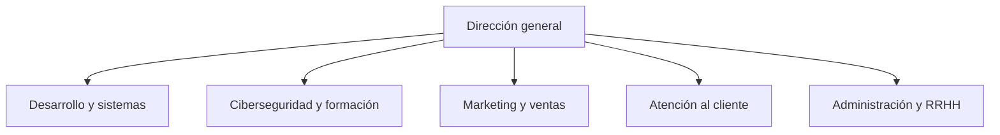

# 01 · Análisis y documentación inicial (RA1)

**Proyecto:** Plataforma web de aprendizaje antiphishing  
**Autor:** Gael García  
**Entrega H1:** 26 de noviembre de 2026

## 1. Sector y empresas (CE 1a, 1b)

El proyecto pertenece al sector de las tecnologías de la información y, concretamente, a la ciberseguridad y la formación digital. Su objetivo es enseñar a los usuarios a reconocer el phishing y otras estafas digitales mediante ejercicios prácticos.

### Clasificación de empresas

| Empresa | Características organizativas | Producto o servicio | Fuente |
|---|---|---|---|
| KnowBe4 | Empresa tecnológica internacional especializada en seguridad humana y formación empresarial | Formación, simulaciones de phishing y seguimiento de resultados | [KnowBe4](https://www.knowbe4.com/products/security-awareness-training) |
| Hoxhunt | Empresa tecnológica especializada en formación y comportamiento de los usuarios | Entrenamiento personalizado, niveles y recompensas | [Hoxhunt](https://support.hoxhunt.com/hc/en-us/articles/4413899603730-Progressing-in-the-Hoxhunt-Phishing-Training) |
| SoSafe | Empresa especializada en concienciación en ciberseguridad, orientada a organizaciones | Formación y simulaciones de phishing y smishing | [SoSafe](https://support.sosafe.de/hc/en-us/articles/38268806074781-Phishing-Simulation) |
| Proofpoint | Empresa internacional de ciberseguridad con diversas líneas de productos empresariales | Protección del correo, formación y evaluación del riesgo humano | [Proofpoint](https://www.proofpoint.com/es/products/security-awareness-training/phishing-simulations) |
| Microsoft | Multinacional tecnológica diversificada, con una división de productos de seguridad | Simulaciones y formación mediante Microsoft Defender para Office 365 | [Microsoft](https://learn.microsoft.com/es-es/defender-office-365/attack-simulation-training-get-started) |

La clasificación distingue entre empresas especializadas en formación, proveedores de ciberseguridad con varios servicios y grandes empresas tecnológicas con soluciones integradas.

### Empresa tipo

Como referencia, se plantea una pequeña o mediana empresa tecnológica dedicada al desarrollo y comercialización de una plataforma de formación en ciberseguridad. Tendría una estructura funcional como la siguiente. Es un modelo de empresa tipo, no el organigrama real de ninguna de las empresas anteriores.

| Departamento | Funciones |
|---|---|
| Dirección general | Define los objetivos, coordina los departamentos y toma decisiones sobre recursos y estrategia. |
| Desarrollo y sistemas | Diseña, programa, prueba, despliega y mantiene la aplicación, la API y la base de datos. |
| Ciberseguridad y formación | Analiza las amenazas, prepara simulaciones educativas y revisa la seguridad y calidad de los contenidos. |
| Marketing y ventas | Estudia el mercado, promociona el producto y busca clientes, especialmente centros educativos y empresas. |
| Atención al cliente | Resuelve dudas e incidencias, recoge sugerencias y ayuda a los usuarios a utilizar la plataforma. |
| Administración y RRHH | Gestiona la contabilidad, facturación, contratación y obligaciones legales. |

## 2. Necesidades y oportunidades (CE 1c, 1d)

La prioridad se establece según el impacto de cada necesidad en la prevención de fraudes y su relación con el objetivo del proyecto. Es una valoración propia basada en los datos de INCIBE y en las funciones que ofrecen las empresas analizadas, no una encuesta de demanda.

| Prioridad | Necesidad | Justificación | Fuente |
|---|---|---|---|
| 1 - Alta | Reconocer correos fraudulentos | El phishing es uno de los principales tipos de fraude digital. | [INCIBE, balance 2025](https://www.observaciber.gob.es/estudios/balance-de-ciberseguridad-2025) |
| 2 - Alta | Detectar SMS y páginas fraudulentas | Los engaños también llegan mediante mensajes y sitios web falsos. | [INCIBE, balance 2025](https://www.observaciber.gob.es/estudios/balance-de-ciberseguridad-2025), [SoSafe](https://support.sosafe.de/hc/en-us/articles/38450069779101-Create-a-Smishing-Simulation) |
| 3 - Alta | Practicar en un entorno seguro y recibir explicaciones | La formación práctica permite reconocer señales de alerta sin exponerse a un ataque real. | [KnowBe4](https://www.knowbe4.com/products/security-awareness-training) |
| 4 - Media | Adaptar el aprendizaje al nivel del usuario | No todos los usuarios tienen los mismos conocimientos de seguridad. | [Hoxhunt](https://support.hoxhunt.com/hc/en-us/articles/4413899603730-Progressing-in-the-Hoxhunt-Phishing-Training) |
| 5 - Media | Consultar los resultados y el progreso | El seguimiento permite identificar errores y aspectos que necesitan más práctica. | [Proofpoint](https://www.proofpoint.com/es/products/security-awareness-training/phishing-simulations) |

### Oportunidades de negocio

Según el Balance de Ciberseguridad 2025 de INCIBE, durante ese año se gestionaron 122.223 incidentes de ciberseguridad, un 26 % más que en 2024. Entre ellos se registraron 45.445 casos de fraude online y 25.133 incidentes de phishing.

Fuente: [Balance de Ciberseguridad 2025 de INCIBE](https://www.observaciber.gob.es/estudios/balance-de-ciberseguridad-2025), consultado el 19/11/2026.

Estos datos muestran que existe una necesidad de mejorar la prevención del fraude digital. No representan el tamaño del mercado ni garantizan que los usuarios estén dispuestos a pagar.

La plataforma podría dirigirse a particulares, centros educativos y pequeñas empresas que quieran mejorar sus conocimientos de ciberseguridad. En un futuro podría ofrecerse una versión básica gratuita y una versión para organizaciones con funcionalidades adicionales. Antes de comercializarla sería necesario validar el interés de los posibles clientes.

## 3. Tipo de proyecto elegido (CE 1e)

He elegido desarrollar una plataforma web educativa sobre phishing y estafas digitales. El usuario verá simulaciones de correos electrónicos, SMS y páginas web y deberá decidir si son legítimas o fraudulentas. Después de responder, recibirá una explicación sobre las señales que permiten identificarlas.

La aplicación contará con niveles de dificultad, puntuaciones y estadísticas personales. Se desarrollará una API REST conectada a una base de datos para gestionar los usuarios, las simulaciones y los resultados.

He valorado otras alternativas, como crear una página informativa sobre phishing o desarrollar una herramienta que analice correos reales. La primera sería menos interactiva y la segunda tendría mayor complejidad técnica y riesgos de privacidad. Por eso he elegido una plataforma de aprendizaje basada en simulaciones ficticias, que permite practicar de forma segura y comprobar el progreso.

La primera versión se centrará en la formación, no en detectar automáticamente ataques reales ni enviar mensajes fraudulentos.

## 4. Requisitos y restricciones (CE 1f)

Los siguientes requisitos definen una primera versión del proyecto. Se han planteado a partir de las necesidades identificadas y de las soluciones del sector analizadas en los apartados anteriores. Queda pendiente contrastarlos con [01b-sota.md](01b-sota.md), el documento específico de estado del arte.

| ID | Requisito | Tipo (funcional / no funcional / restricción) | Cómo se verifica |
|---|---|---|---|
| RF-01 | El usuario podrá registrarse con correo y contraseña e iniciar y cerrar sesión. | funcional | Registrar un usuario de prueba, iniciar sesión y cerrarla. Comprobar que se rechaza una contraseña incorrecta. |
| RF-02 | La aplicación mostrará simulaciones de tres tipos: correo electrónico, SMS y página web. | funcional | Comprobar que se puede visualizar al menos una simulación de cada tipo. |
| RF-03 | El usuario podrá clasificar cada simulación como legítima o fraudulenta. | funcional | Enviar ambas opciones en casos de prueba y comprobar que se evalúan correctamente. |
| RF-04 | Después de cada respuesta, la aplicación indicará si es correcta y mostrará una explicación con al menos una señal relevante. | funcional | Responder correctamente e incorrectamente y revisar los mensajes mostrados. |
| RF-05 | Habrá tres niveles de dificultad: fácil, medio y difícil. | funcional | Seleccionar cada nivel y comprobar que se muestran las simulaciones correspondientes. |
| RF-06 | El usuario recibirá 10 puntos por cada respuesta correcta y 0 por cada incorrecta, sin sumar dos veces por la misma simulación. | funcional | Resolver tres simulaciones, dos bien y una mal; comprobar que obtiene 20 puntos y que repetir el envío no aumenta la puntuación. |
| RF-07 | El perfil del usuario mostrará su puntuación, número de respuestas, aciertos, errores y porcentaje de aciertos. | funcional | Con dos aciertos y un error, comprobar que se muestran 3 respuestas, 2 aciertos, 1 error y 66,67 % de aciertos. |
| RF-08 | Un administrador podrá crear, consultar, modificar y eliminar simulaciones. | funcional | Realizar las cuatro operaciones con una cuenta de administrador y comprobar los cambios en la base de datos. |
| RF-09 | La API REST permitirá gestionar usuarios, consultar simulaciones, registrar respuestas y consultar estadísticas. | funcional | Probar los endpoints con un cliente HTTP, como Postman, y comprobar respuestas JSON y códigos de estado correctos. |
| RF-10 | Los usuarios, las simulaciones y los resultados se guardarán en una base de datos persistente. | funcional | Reiniciar la aplicación y comprobar que los datos continúan disponibles. |
| RF-11 | El usuario podrá eliminar su cuenta y sus resultados asociados. | funcional | Eliminar una cuenta de prueba y comprobar que ya no permite iniciar sesión y que sus resultados se han eliminado. |
| RNF-01 | Al menos 95 de 100 consultas de lectura de la API responderán en 2 segundos o menos en el entorno local de pruebas, con 10 usuarios concurrentes. | no funcional | Ejecutar una prueba de carga de 100 peticiones y registrar tiempos y entorno utilizado. |
| RNF-02 | Las contraseñas se almacenarán mediante un hash seguro con sal, nunca en texto plano; el despliegue publicado utilizará HTTPS. | no funcional | Revisar la base de datos y comprobar el protocolo mediante el navegador. |
| RNF-03 | Cada usuario solo podrá consultar sus propios resultados y únicamente el administrador podrá modificar simulaciones. | no funcional | Intentar acceder a resultados de otro usuario o modificar simulaciones sin permisos y comprobar que la API rechaza la petición. |
| RNF-04 | La interfaz deberá funcionar en pantallas de 360 y 1280 píxeles de ancho sin desplazamiento horizontal en las pantallas principales. | no funcional | Comprobar ambas resoluciones mediante las herramientas del navegador. |
| RNF-05 | Las acciones principales deberán ser utilizables con teclado y los formularios tendrán etiquetas visibles o accesibles. | no funcional | Navegar con Tab y Enter y revisar las etiquetas de los campos. |
| RNF-06 | Los ejercicios no enviarán correos ni SMS reales, no enlazarán a sitios fraudulentos activos y no solicitarán credenciales reales de terceros. | no funcional | Revisar los contenidos y comprobar que todos los enlaces simulados son inactivos o internos y que no hay formularios de captura de credenciales de terceros. |
| REST-01 | La primera entrega H1 deberá estar disponible en GitHub el 26/11/2026. | restricción | Comprobar la fecha de la entrega en el repositorio. |
| REST-02 | Se utilizará una arquitectura web con interfaz, API REST y base de datos relacional. | restricción | Revisar la arquitectura y el esquema de datos. |
| REST-03 | El presupuesto inicial de licencias de software será de 0 euros. | restricción | Revisar las licencias de las herramientas y dependencias utilizadas. |
| REST-04 | El tratamiento de datos personales deberá respetar el RGPD y la LOPDGDD cuando resulten aplicables. Para las pruebas académicas se utilizarán datos ficticios. | restricción | Revisar los datos de prueba, la información de privacidad y los mecanismos de eliminación de cuentas. |

Las tecnologías concretas de programación se confirmarán según las indicaciones del módulo y el estado del arte, sin imponer en esta fase un framework que todavía no se haya decidido.

### Matriz de trazabilidad

En esta entrega se relacionan los objetivos y los requisitos. Los casos de uso, pantallas, endpoints concretos y pruebas se completarán en las siguientes fases.

| Objetivo | Requisito | Caso de uso | Pantalla o endpoint | Prueba o indicador |
|---|---|---|---|---|
| OBJ-01 Gestionar las cuentas de usuario | RF-01 | | | pendiente |
| OBJ-01 Gestionar las cuentas de usuario | RF-11 | | | pendiente |
| OBJ-02 Enseñar a reconocer el fraude digital | RF-02 | | | pendiente |
| OBJ-02 Enseñar a reconocer el fraude digital | RF-03 | | | pendiente |
| OBJ-02 Enseñar a reconocer el fraude digital | RF-04 | | | pendiente |
| OBJ-02 Enseñar a reconocer el fraude digital | RF-05 | | | pendiente |
| OBJ-02 Enseñar a reconocer el fraude digital | RNF-06 | | | pendiente |
| OBJ-03 Medir el progreso del usuario | RF-06 | | | pendiente |
| OBJ-03 Medir el progreso del usuario | RF-07 | | | pendiente |
| OBJ-04 Gestionar y almacenar los datos de la plataforma | RF-08 | | | pendiente |
| OBJ-04 Gestionar y almacenar los datos de la plataforma | RF-09 | | | pendiente |
| OBJ-04 Gestionar y almacenar los datos de la plataforma | RF-10 | | | pendiente |
| OBJ-05 Ofrecer una aplicación segura y fácil de utilizar | RNF-01 | | | pendiente |
| OBJ-05 Ofrecer una aplicación segura y fácil de utilizar | RNF-02 | | | pendiente |
| OBJ-05 Ofrecer una aplicación segura y fácil de utilizar | RNF-03 | | | pendiente |
| OBJ-05 Ofrecer una aplicación segura y fácil de utilizar | RNF-04 | | | pendiente |
| OBJ-05 Ofrecer una aplicación segura y fácil de utilizar | RNF-05 | | | pendiente |

## 5. Obligaciones fiscales, laborales y de prevención (CE 1g)

Actualmente se trata de un proyecto académico individual, sin actividad comercial ni empleados. Por tanto, no nace por su mera realización la obligación de darse de alta como empresa o contratar trabajadores. Si en el futuro se comercializara en España, habría que tener en cuenta las siguientes obligaciones según la forma de actividad elegida.

| Obligación | Norma | Condiciones de aplicación |
|---|---|---|
| Alta censal de la actividad económica | Ley 58/2003, General Tributaria, y RD 1065/2007 | Presentar el modelo 036 antes de iniciar la actividad económica cuando corresponda. |
| IVA | Ley 37/1992, del IVA | Repercutir y declarar el IVA por los servicios de pago, salvo que resulte aplicable una exención o regla especial. |
| IRPF o Impuesto sobre Sociedades | Ley 35/2006 y Ley 27/2014 | Tributar por los rendimientos si se desarrolla la actividad como autónomo, o por los beneficios de la sociedad si se constituye una empresa. |
| Facturación | RD 1619/2012 | Emitir y conservar las facturas cuando exista obligación de facturar. |
| Seguridad Social | RDL 8/2015, Ley General de la Seguridad Social | Tramitar el alta en el régimen correspondiente si se realiza una actividad por cuenta propia que reúna los requisitos legales. |
| Contratación laboral | RDL 2/2015, Estatuto de los Trabajadores | Si se contrata personal, formalizar la relación laboral y cumplir las obligaciones relativas a salarios, jornada, altas y cotizaciones. |
| Prevención de riesgos laborales | Ley 31/1995 | Si existe personal contratado, evaluar los riesgos, planificar la prevención y proporcionar formación e información. |
| Trabajo con pantallas | RD 488/1997 | Para trabajadores incluidos en su ámbito, evaluar los riesgos de fatiga visual y posturales y adoptar medidas ergonómicas y descansos o cambios de actividad. |
| Protección de datos | Reglamento (UE) 2016/679 (RGPD) y LO 3/2018 (LOPDGDD) | Cuando se traten datos personales reales, disponer de una base jurídica, informar al usuario, limitar la recogida de datos, protegerlos y permitir el ejercicio de sus derechos. |
| Servicios web y comercio electrónico | Ley 34/2002 (LSSI-CE) | Si se presta un servicio incluido en su ámbito, publicar la información legal correspondiente y cumplir las reglas sobre contratación electrónica y cookies, cuando sean aplicables. |

Durante el desarrollo académico utilizaré datos ficticios, contraseñas protegidas, control de permisos y simulaciones que no puedan provocar fraudes reales. También procuraré mantener una postura adecuada y realizar descansos durante el trabajo con el ordenador.

Fuentes oficiales: [BOE - legislación consolidada](https://www.boe.es/buscar/legislacion.php), [Ley de Prevención de Riesgos Laborales](https://www.boe.es/eli/es/l/1995/11/08/31), [LSSI-CE](https://www.boe.es/buscar/act.php?id=BOE-A-2002-13758) y [RGPD](https://eur-lex.europa.eu/eli/reg/2016/679/oj?locale=es).

## 6. Ayudas y subvenciones (CE 1h)

Una posible ayuda para una futura evolución empresarial del proyecto es el programa de subvenciones a empresas de base tecnológica (EBT) de la Agencia Sekuens del Principado de Asturias.

| Aspecto | Información |
|---|---|
| Ayuda | Subvenciones dirigidas a empresas de base tecnológica en Asturias, convocatoria 2026. |
| Organismo | Agencia Sekuens, Principado de Asturias. |
| Finalidad | Apoyar la creación y el crecimiento de empresas de base tecnológica mediante proyectos de investigación y desarrollo tecnológico. |
| Requisitos | Empresa con personalidad jurídica propia válidamente constituida, centro de trabajo en Asturias, proyecto desarrollado en Asturias y cumplimiento de las condiciones de la convocatoria. |
| Presupuesto de la convocatoria | 1.400.000 euros en total, repartidos entre creación y crecimiento de empresas. No es una cantidad por beneficiario. |
| Plazo | Hasta las 14:00 del 17 de septiembre de 2026. Convocatoria cerrada en la fecha de este documento. |
| Fuente | [Principado de Asturias - requisitos y plazo](https://juventud.asturias.es/-/subvenciones-dirigidas-a-empresas-de-base-tecnol%C3%B3gica) y [Principado de Asturias - presupuesto 2026](https://juventud.asturias.es/-/abierta-la-convocatoria-de-subvenciones-a-empresas-de-base-tecnol%C3%B3gica-2026%C2%A0). |

Esta ayuda podría ser interesante si el proyecto evolucionase hacia una empresa tecnológica innovadora y cumpliese los requisitos de una nueva convocatoria. Actualmente, como estudiante y sin una empresa constituida, no puedo solicitarla en esas condiciones. No se contempla ninguna subvención como financiación asegurada del proyecto.

## 7. Guion de trabajo (CE 1i)

El proyecto se desarrollará por fases. Al ser un proyecto individual, seré el responsable de las tareas de análisis, diseño, desarrollo, pruebas y documentación.

| Fase | Tareas | Hito o resultado | Responsable |
|---|---|---|---|
| 1. Análisis | Investigar el sector, estudiar alternativas, definir objetivos y requisitos. | H1: documentación inicial, 26/11/2026. | Gael García |
| 2. Diseño | Diseñar la interfaz, la arquitectura, la base de datos y los endpoints de la API. | Diseño y planificación técnica terminados. | Gael García |
| 3. Desarrollo del backend | Implementar usuarios, simulaciones, respuestas, puntuaciones y persistencia de datos. | API REST operativa y conectada a la base de datos. | Gael García |
| 4. Desarrollo del frontend | Crear las pantallas y conectar la interfaz con la API. | Aplicación navegable con las funcionalidades principales. | Gael García |
| 5. Pruebas | Comprobar funcionalidades, seguridad, accesibilidad y rendimiento; corregir errores. | Pruebas documentadas y matriz de trazabilidad completada. | Gael García |
| 6. Despliegue y documentación | Configurar el entorno, publicar la aplicación y preparar la documentación final. | Aplicación desplegada y memoria final. | Gael García |
| 7. Presentación | Preparar la demostración y explicar el funcionamiento. | Exposición del proyecto. | Gael García |

Utilizaré GitHub para guardar los cambios, organizar las tareas y mantener la documentación. Las fechas de las fases posteriores a H1 se ajustarán al calendario oficial de entregas del módulo.

## 8. Glosario

| Término | Definición | Sinónimos que NO uso |
|---|---|---|
| Phishing | Engaño que suplanta a una entidad o persona de confianza para conseguir información o provocar una acción perjudicial. En el proyecto se utiliza principalmente para el fraude mediante correo o web. | Pesca de datos |
| Smishing | Modalidad de phishing realizada mediante mensajes SMS. | SMS phishing |
| Simulación | Ejercicio ficticio que representa una comunicación o página legítima o fraudulenta para entrenar al usuario. | Reto, escenario, ataque de prueba |
| Usuario | Persona registrada que realiza simulaciones y consulta sus resultados. | Jugador, alumno, participante |
| Respuesta | Clasificación de una simulación como legítima o fraudulenta realizada por el usuario. | Voto, elección |
| Puntuación | Total de puntos obtenidos mediante las respuestas correctas. | Score, marcador |
| API REST | Interfaz que permite intercambiar datos entre la aplicación y el servidor mediante peticiones HTTP. | Web service (como denominación del componente) |
| Nivel de dificultad | Categoría fácil, media o difícil que indica la complejidad de una simulación. | Rango, grado |

---

## Criterios de evaluación de este documento (RA1, texto literal)

- **1a)** Se han clasificado las empresas del sector por sus características organizativas y el tipo de producto o servicio que ofrecen.
- **1b)** Se han caracterizado las empresas tipo indicando la estructura organizativa y las funciones de cada departamento.
- **1c)** Se han identificado las necesidades más demandadas a las empresas.
- **1d)** Se han valorado las oportunidades de negocio previsibles en el sector.
- **1e)** Se ha identificado el tipo de proyecto requerido para dar respuesta a las demandas previstas.
- **1f)** Se han determinado las características específicas requeridas al proyecto.
- **1g)** Se han determinado las obligaciones fiscales, laborales y de prevención de riesgos y sus condiciones de aplicación.
- **1h)** Se han identificado posibles ayudas o subvenciones para la incorporación de nuevas tecnologías de producción o de servicio que se proponen.
- **1i)** Se ha elaborado el guión de trabajo que se va a seguir para la elaboración del proyecto.
